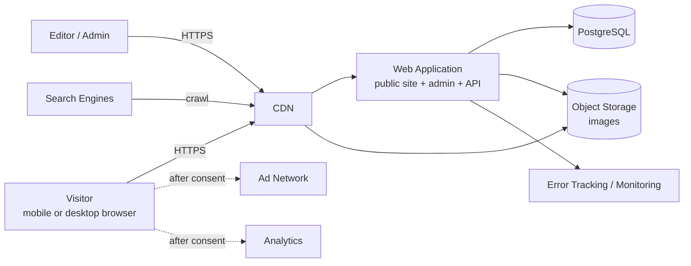

# Architecture Document

## AI Prompt Library, Phase A (with evolution path to Phases B to D)

## 1. Document Control

| Field | Value |
|-------|-------|
| Document ID | ARCH-001 |
| Version | 0.1 (Draft) |
| Status | DRAFT, contingent on approval of ADR-001 to ADR-006 |
| Author | Master Claude (AI) |
| Approver | Product Owner |
| Last updated | 2026-10-18 |
| Related | PRODUCT_SPEC.md (PRD-001), DECISIONS.md (ADR-LOG-001), DATABASE.md, API_CONTRACTS.md |

### Revision History

| Version | Date | Change |
|---------|------|--------|
| 0.1 | 2026-10-18 | Initial architecture draft |

**Evidence labels:** `[PROPOSED]` recommended, needs approval. `[ASSUMPTION]` needs validation. `[OPEN]` unanswered.

## 2. Purpose and Scope

This document describes how Phase A of the product is structured: the public prompt library, the admin panel, data, media, security, deployment, and observability. It also states which choices keep Phases B to D feasible without building them now.

**Out of scope for Phase A:** user accounts, payments, AI generation, multi-tenant features, native apps.

## 3. Architectural Drivers

| Driver | Source | Architectural consequence |
|--------|--------|---------------------------|
| Mobile speed and SEO | NFR-001, NFR-002 | Pre-rendered pages, CDN caching, strict JavaScript budget |
| Image-heavy content | FR-023 | Object storage, CDN, pre-generated responsive variants |
| Ads without harming performance | FR-010, NFR-001 | Consent-gated, lazy-loaded ads with reserved slots |
| Fast takedown | FR-026 | Targeted cache invalidation, unpublish within minutes |
| Small team, low operations | PRD 13.2 | Single application, one database, managed services |
| Future SaaS phases | PRD Section 6 | Role model, workspace column, entitlement hook points |
| Security and privacy | NFR-004, NFR-005 | Defense in depth, least privilege, consent management |

## 4. System Context (C4 Level 1)



## 5. Container View (C4 Level 2) [PROPOSED]

| Container | Responsibility | Technology (per ADRs) |
|-----------|----------------|-----------------------|
| Web application | Server-rendered public pages, admin UI, JSON API, scheduled-job endpoint | Next.js, TypeScript (ADR-001, pending SPIKE-1) |
| Database | Prompts, taxonomy, media metadata, users, audit log | Managed PostgreSQL (ADR-002) |
| Object storage | Original uploads and generated image variants | S3-compatible storage (ADR-003) |
| CDN | Cache HTML and images, TLS, DDoS and basic WAF protection | Provider TBD (ADR-003) |
| Scheduler | Triggers scheduled publishing every minute | Managed cron calling a protected endpoint |
| Observability | Error tracking, uptime checks, logs | Provider TBD |

No microservices, queues, or second database in Phase A. A job queue is introduced only when Phase C requires long-running AI work.

## 6. Application Structure [PROPOSED]

```
/app                 routes: (public), (admin), api
/src
  /domain            prompts, taxonomy, media (business rules, no framework code)
  /data              repositories, migrations, queries
  /services          publishing, search, image pipeline, audit
  /security          auth, authorization, rate limit, validation
  /ui                design-system components
/docs                project documentation
/tests               unit, integration, end-to-end
```

Principles: business rules live in `/domain` and `/services`, not in route handlers; every external input is validated at the boundary; the data layer is the only code that talks to the database.

## 7. Rendering and Caching Strategy [PROPOSED]

| Page type | Rendering | Cache | Invalidation |
|-----------|-----------|-------|--------------|
| Home, category, tag listings | Pre-rendered with periodic regeneration | CDN, short TTL | On publish, unpublish, takedown |
| Prompt detail | Pre-rendered on first request, then cached | CDN, long TTL | Per-URL purge on edit or takedown |
| Search results | Server-rendered per request | Short TTL or none | None |
| Static pages (About, legal) | Pre-rendered | CDN, long TTL | On deploy |
| Admin | Dynamic, never cached | `no-store` | Not applicable |
| `sitemap.xml` | Generated | CDN, short TTL | On publish or unpublish |

Public pages must be crawlable without client-side JavaScript (NFR-002).

## 8. Key Flows

### 8.1 Visitor views and copies a prompt

1. Browser requests the prompt URL; CDN serves cached HTML or fetches it from the application.
2. HTML contains title, text, metadata, and responsive image tags pointing to CDN-hosted variants.
3. Consent banner is shown if required. Ad and analytics scripts load only after consent.
4. On Copy tap, client script writes the prompt text to the clipboard and shows confirmation. If clipboard access is blocked, it selects the text and shows a manual-copy hint (FR-005).
5. Optional anonymous copy event is sent to analytics, only with consent where required.

### 8.2 Editor publishes a prompt

1. Editor authenticates, creates a draft, uploads an image (see 9), fills SEO fields.
2. Editor publishes immediately or schedules a time.
3. Service validates required fields (alt text, slug, category), sets state, writes an audit record, and invalidates affected cache entries and the sitemap.

### 8.3 Scheduled publishing

1. Scheduler calls a protected endpoint every minute.
2. Application publishes all prompts whose scheduled time has passed, in one transaction per prompt, idempotently.
3. Cache and sitemap are refreshed. Target: public within 5 minutes of the scheduled time.

### 8.4 Takedown

1. Admin triggers takedown on a prompt.
2. Application unpublishes it, records the reason in the audit log, purges CDN entries for the page, listings, sitemap, and image variants.
3. Public URL returns 410 Gone (or 404). Target: effective within 5 minutes (FR-026).

## 9. Media Pipeline [PROPOSED]

1. Admin requests an upload intent; application returns a short-lived signed upload URL.
2. Browser uploads the original to object storage.
3. Application verifies the file (type by content, not extension; size limit; decodable image).
4. Application generates variants (for example widths 320, 640, 960, 1280) in WebP and AVIF, strips EXIF metadata, and stores them with immutable, content-hashed keys.
5. Metadata (dimensions, alt text, checksum) is saved. Images are served via CDN with long-lived cache headers.

Rules: allow JPEG, PNG, WebP only; reject SVG and animated formats in Phase A; maximum original size is `[PROPOSED]` 10 MB; alt text is required to publish.

## 10. Search [PROPOSED]

PostgreSQL full-text search over title, prompt text, category and tag names, with trigram matching for typo tolerance. This avoids a separate search service in Phase A. Revisit if the catalog or query load outgrows it.

## 11. Advertising and Consent Architecture

- A single consent module is the only code allowed to load third-party scripts.
- Ad slots have fixed, reserved dimensions to prevent layout shift.
- Ad loading is deferred until after consent and after primary content is rendered.
- All ad code sits behind one interface so Phase B can disable it for paid users.
- A Content Security Policy is maintained with an explicit allowlist for approved ad and analytics domains. `[OPEN]` final allowlist depends on the chosen ad and consent providers.

## 12. Security Architecture

| Area | Design |
|------|--------|
| Transport | HTTPS only, HSTS, modern TLS |
| Authentication | Password hashing with a modern memory-hard algorithm; secure session cookies (HttpOnly, Secure, SameSite); login throttling; optional multi-factor authentication for admin (`[PROPOSED]` Should) |
| Authorization | Role-based (admin, editor); checked server-side on every admin route and API; deny by default |
| CSRF/XSS | CSRF protection on state-changing requests; output encoding; CSP; sanitize any rich text; prompt text rendered as plain text |
| Input validation | Schema validation at every boundary; parameterized queries only |
| Upload safety | Content-based type checks, size limits, re-encoding, no execution of uploads, private original bucket |
| Rate limiting | Per-IP limits on search, login, and public API (`[PROPOSED]` values set in implementation tasks) |
| Secrets | Environment-based secret store; never in source, logs, Issues, or PR comments; rotation documented in SECRETS.md |
| Headers | CSP, X-Content-Type-Options, Referrer-Policy, frame protections |
| Dependencies | Lockfile installs, vulnerability scanning, secret scanning, pinned CI actions |
| Audit | Admin actions recorded with actor, time, and target (FR-027) |
| Tenant isolation | Workspace column present from day one (ADR-004); no tenant features in Phase A |

Threats to review in a formal threat model before launch: admin account takeover, malicious upload, scraping/abuse, copyright takedown abuse, ad-script supply chain, dependency vulnerabilities.

## 13. Observability and Operations

- **Error tracking** for server and browser errors (no sensitive data).
- **Uptime checks** on home page and a health endpoint.
- **Structured logs** with request IDs; no secrets or personal data.
- **Metrics:** latency, error rate, cache hit ratio, publish and takedown durations.
- **Alerts:** downtime, elevated 5xx rate, failed scheduled job, failed backup.
- **Real-user monitoring** of Core Web Vitals (consent permitting).

## 14. Performance Budget [PROPOSED]

| Metric | Target (75th percentile, mobile) |
|--------|----------------------------------|
| Largest Contentful Paint | 2.5 s or better |
| Interaction to Next Paint | 200 ms or better |
| Cumulative Layout Shift | 0.1 or better |
| First-party JavaScript on prompt page | Budget `[OPEN]`, set after SPIKE-1 |
| Third-party scripts | Counted in the budget; loaded after consent and primary content |

The first three are Google's published "good" thresholds. The JavaScript budget is set from SPIKE-1 measurements.

## 15. Environments and Deployment [PROPOSED]

| Environment | Purpose | Data |
|-------------|---------|------|
| Local | Development | Seeded fake data |
| CI | Automated checks on every PR | Ephemeral database |
| Staging | Pre-production verification and smoke tests | Non-sensitive test data |
| Production | Live traffic | Real data |

Pipeline (details in `docs/devops/`): PR checks, independent review, authorized merge to `main`, build a versioned artifact, deploy to staging, smoke tests, human approval, deploy the same artifact to production, health checks, monitoring. Rollback uses the previous artifact; database migrations are backward-compatible and reviewed. Exact hosting is deferred (ADR-003, OQ-5).

## 16. Backup and Recovery

- Daily automated database backups plus point-in-time recovery if offered by the provider.
- Object storage versioning for originals.
- Restore drill before launch and periodically afterwards.
- Targets: RPO 24 hours, RTO 4 hours (`[PROPOSED]`, NFR-007).

## 17. Testing Strategy

| Level | Scope |
|-------|-------|
| Unit | Domain rules (publish states, slug rules, validation) |
| Integration | Data layer, publishing service, image pipeline against a real test database |
| API | Contract tests against API_CONTRACTS.md |
| End-to-end | Visit prompt, copy, search, admin publish, takedown |
| Accessibility | Automated checks plus manual keyboard and screen-reader pass (WCAG 2.2 AA) |
| Security | Dependency, secret, and static analysis; authorization tests for every admin route |
| Performance | Lighthouse-style lab checks in CI against the budget; field data after launch |

## 18. Evolution Path (Phases B to D)

| Phase | Architectural additions | Prepared in Phase A by |
|-------|-------------------------|------------------------|
| B | User accounts, sessions, billing provider, entitlements, ad-free toggle | Role model, isolated ad module, user table |
| C | Job queue and workers, AI provider adapter, credits ledger, moderation, stricter rate limits | Service layer boundaries, audit log |
| D | Multi-tenant workspaces, custom domains, tenant-scoped authorization | `workspace_id` column, domain/service separation |

## 19. Risks and Open Items

| ID | Item | Status |
|----|------|--------|
| A-1 | ADR-001 depends on SPIKE-1 results | OPEN |
| A-2 | Hosting and CDN provider undecided (budget unknown) | OPEN |
| A-3 | Consent and ad providers undecided; CSP allowlist unfinished | OPEN |
| A-4 | Content language undecided (affects URLs, `locale` handling, SEO tags) | OPEN |
| A-5 | Formal threat model not yet written | OPEN |
| A-6 | Next.js patch cadence requires an upgrade policy | OPEN |

## 20. Approval Log

| Item | Status | Approved by | Date |
|------|--------|-------------|------|
| Architecture overview (this document) | PENDING | | |
