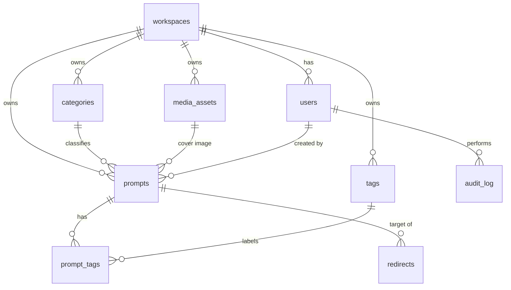

# Database Design Document

## 1. Document Control

| Field | Value |
|-------|-------|
| Document ID | DB-001 |
| Version | 0.1 (Draft) |
| Status | DRAFT, contingent on ADR-002 and ADR-004 approval |
| Author | Master Claude (AI) |
| Approver | Product Owner |
| Last updated | 2026-10-18 |
| Related | PRODUCT_SPEC.md, ARCHITECTURE.md (ARCH-001), API_CONTRACTS.md |

| Version | Date | Change |
|---------|------|--------|
| 0.1 | 2026-10-18 | Initial Phase A data model |

**Labels:** `[PROPOSED]` needs approval. `[OPEN]` unanswered.

## 2. Scope

Physical and logical design for Phase A on PostgreSQL. Later-phase tables (Section 9) are listed for planning only and must not be created in Phase A.

## 3. Conventions [PROPOSED]

- Table and column names: `snake_case`; table names plural.
- Primary keys: UUID (`id`), generated by the application or database.
- Timestamps: `timestamptz` in UTC; every table has `created_at` and `updated_at`.
- Content tables carry `workspace_id` (ADR-004). Phase A has exactly one workspace row.
- Soft state via status columns, not row deletion, for content that was ever published.
- Foreign keys enforced; `ON DELETE RESTRICT` by default.
- Enumerations implemented as constrained text or native enums (decided at implementation).
- All schema changes via versioned, reviewed migrations. Prefer backward-compatible changes (expand, migrate, contract).

## 4. Entity Relationship Diagram

## 5. Tables

### 5.1 `workspaces`

| Column | Type | Constraints | Notes |
|--------|------|-------------|-------|
| id | uuid | PK | |
| name | text | not null | Site name |
| default_locale | text | not null | `[OPEN]` depends on OQ-1 |
| created_at, updated_at | timestamptz | not null | |

### 5.2 `users` (admin and editor accounts in Phase A)

| Column | Type | Constraints | Notes |
|--------|------|-------------|-------|
| id | uuid | PK | |
| workspace_id | uuid | FK, not null | |
| email | citext | not null, unique | Case-insensitive |
| password_hash | text | not null | Memory-hard hash; never logged |
| role | text | not null | `admin` or `editor` |
| is_active | boolean | not null, default true | |
| mfa_enabled | boolean | not null, default false | |
| last_login_at | timestamptz | | |
| created_at, updated_at | timestamptz | not null | |

Phase B extends this table or links a separate public-user table (decision deferred to a Phase B ADR).

### 5.3 `categories`

| Column | Type | Constraints |
|--------|------|-------------|
| id | uuid | PK |
| workspace_id | uuid | FK, not null |
| name | text | not null |
| slug | text | not null |
| description | text | |
| sort_order | int | not null, default 0 |
| created_at, updated_at | timestamptz | not null |

Unique: `(workspace_id, slug)`.

### 5.4 `tags`

Same shape as `categories` without `sort_order`. Unique: `(workspace_id, slug)`.

### 5.5 `media_assets`

| Column | Type | Constraints | Notes |
|--------|------|-------------|-------|
| id | uuid | PK | |
| workspace_id | uuid | FK, not null | |
| storage_key | text | not null, unique | Original in private storage |
| mime_type | text | not null | jpeg, png, webp |
| width, height | int | not null | |
| bytes | bigint | not null | |
| checksum_sha256 | text | not null | Dedup and integrity |
| alt_text | text | not null | Required for publishing |
| variants | jsonb | not null, default `[]` | Width, format, key, bytes for each variant |
| status | text | not null | `pending`, `ready`, `failed` |
| uploaded_by | uuid | FK users | |
| created_at, updated_at | timestamptz | not null | |

### 5.6 `prompts`

| Column | Type | Constraints | Notes |
|--------|------|-------------|-------|
| id | uuid | PK | |
| workspace_id | uuid | FK, not null | |
| locale | text | not null | `[OPEN]` OQ-1 |
| title | text | not null | |
| slug | text | not null | URL segment |
| prompt_text | text | not null | Plain text only |
| how_to_use | text | | Short guidance |
| category_id | uuid | FK categories, not null | |
| cover_media_id | uuid | FK media_assets | Required to publish |
| status | text | not null | `draft`, `scheduled`, `published`, `archived`, `taken_down` |
| scheduled_at | timestamptz | | Required when `scheduled` |
| published_at | timestamptz | | Set on first publish |
| seo_title | text | | Falls back to title |
| seo_description | text | | |
| rights_note | text | not null | Source/license record (risk R-2) |
| created_by, updated_by | uuid | FK users | |
| search_vector | tsvector | generated | Full-text search |
| created_at, updated_at | timestamptz | not null | |

Constraints:
- Unique `(workspace_id, locale, slug)`.
- Check: `status = 'scheduled'` implies `scheduled_at` is not null.
- Check: `status = 'published'` implies `published_at` and `cover_media_id` are not null.

Indexes:
- `(workspace_id, status, published_at DESC)` for listings.
- `(workspace_id, category_id, status, published_at DESC)` for category pages.
- `(status, scheduled_at)` partial index where `status = 'scheduled'` for the scheduler.
- GIN on `search_vector`; trigram GIN on `title` for typo tolerance.

### 5.7 `prompt_tags`

| Column | Type | Constraints |
|--------|------|-------------|
| prompt_id | uuid | FK prompts, PK part |
| tag_id | uuid | FK tags, PK part |

Index on `tag_id` for tag pages.

### 5.8 `redirects`

| Column | Type | Constraints |
|--------|------|-------------|
| id | uuid | PK |
| workspace_id | uuid | FK, not null |
| from_path | text | not null |
| to_path | text | not null |
| status_code | int | not null, 301 or 410 |
| created_at | timestamptz | not null |

Unique `(workspace_id, from_path)`. Created automatically when a published slug changes.

### 5.9 `audit_log`

| Column | Type | Constraints | Notes |
|--------|------|-------------|-------|
| id | uuid | PK | |
| workspace_id | uuid | FK, not null | |
| actor_id | uuid | FK users | |
| action | text | not null | For example `prompt.publish`, `prompt.takedown`, `user.login_failed` |
| target_type | text | not null | |
| target_id | uuid | | |
| metadata | jsonb | | No secrets or personal data beyond IDs |
| ip_address_hash | text | | Hashed or truncated per privacy policy |
| created_at | timestamptz | not null | |

Append-only: the application role has insert and select only on this table.

## 6. State Machine: `prompts.status`

| From | To | Trigger | Rule |
|------|----|---------|------|
| draft | published | Publish | Required fields complete, alt text present |
| draft | scheduled | Schedule | `scheduled_at` in the future |
| scheduled | published | Scheduler | `scheduled_at` reached |
| scheduled | draft | Unschedule | |
| published | draft | Unpublish | Page returns 404 or 410 |
| published | taken_down | Takedown | Reason required in audit log; cache purged |
| published | archived | Archive | Removed from listings |
| taken_down | draft | Restore | Admin only |

Only `published` prompts are visible publicly, appear in search, and appear in the sitemap.

## 7. Search

Generated `search_vector` over title, prompt text, category name, and tags. Query by `websearch_to_tsquery` or equivalent with ranking; fall back to trigram similarity on title. Language configuration depends on OQ-1.

## 8. Security, Privacy, and Retention

- Application connects with a least-privilege role; migrations use a separate role.
- No payment data and no end-visitor personal data are stored in Phase A.
- Admin email and password hashes are the only personal data; passwords are never stored or logged in plain text.
- Backups are encrypted; restore tested before launch (see ARCH-001 Section 16).
- Retention: audit log kept `[OPEN]` period, to be set with legal review.

## 9. Planned Later-Phase Entities (not created in Phase A)

| Phase | Entities |
|-------|----------|
| B | `accounts`, `favorites`, `collections`, `subscriptions`, `entitlements`, `payment_events` |
| C | `ai_jobs`, `credit_ledger`, `moderation_events`, `provider_usage` |
| D | `workspace_members`, `custom_domains`, `workspace_plans` |

Each requires its own ADR and migration review before creation.

## 10. Migration and Seed Policy

- Every migration is reviewed in a PR and tested in CI against an empty database and against a copy of the previous schema with sample data.
- Destructive migrations (dropping columns or tables, data rewrites) require explicit owner approval and a verified backup.
- Seed data (one workspace, sample categories) is created by a script and never contains real secrets.

## 11. Open Items

| ID | Item |
|----|------|
| D-1 | Locale model depends on OQ-1 (single language vs. translations table) |
| D-2 | ORM and migration tool selection |
| D-3 | Audit log retention period |
| D-4 | Whether `status` uses native enums or constrained text |

## 12. Approval Log

| Item | Status | Approved by | Date |
|------|--------|-------------|------|
| Phase A data model | PENDING | | |
